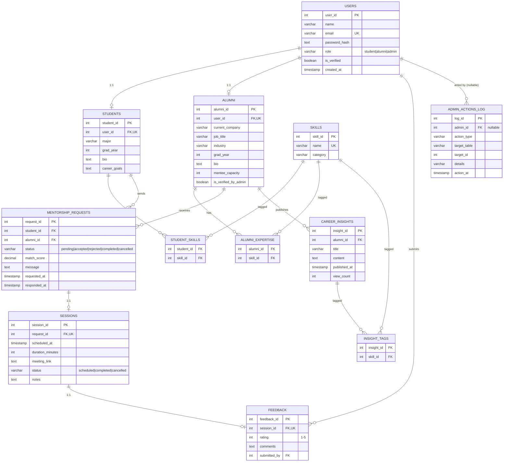

# Campus Alumni Mentorship & Career Insights Hub

**DBMS Experiential Learning — Level 3 Project**
A full-stack mentorship and career-insights platform combining **MySQL 8.0**
(normalized relational schema, ACID transactions, views, triggers, stored
procedures, constraints, indexes, full-text search) with **Qdrant** vector
search over **Gemini embeddings** for semantic alumni-mentor matching.

> Students post a free-text description of the kind of mentor they want;
> their query is embedded and matched by cosine similarity against alumni
> bios, while every booking, capacity check, and verification action runs
> inside an ACID MySQL transaction.

---

## 1. Problem Statement & Objectives

University career offices and alumni networks typically expose a static
directory: a list of names and job titles with no way to find *who actually
matches what a student needs*, and no structured record of whether
mentorship actually happened. This project builds:

- A **relational core** (MySQL) that enforces who-can-book-whom, prevents a
  mentor's capacity from being over-booked, and keeps an auditable trail of
  every admin verification decision.
- A **semantic discovery layer** (Gemini embeddings + Qdrant) so a student
  can describe what they need in plain language instead of browsing by
  exact skill-tag match.
- A **role-based web application** (Next.js) that ties the two together:
  Student / Alumni / Admin dashboards backed entirely by the database layer
  below — no mock data.

## 2. Scope

In scope: account registration & auth, admin verification workflow, mentor
directory & semantic search, mentorship request → accept/reject → schedule
→ complete lifecycle, session feedback, career-insight publishing & search,
platform analytics. Out of scope: payments, video conferencing (sessions
store an external meeting link rather than hosting calls), and mobile apps.

## 3. Functional Requirements

| # | Requirement | Where it's implemented |
|---|---|---|
| 1 | Students & alumni register with role-specific profiles | `/api/auth/register`, `sql/01_schema.sql` |
| 2 | Admin must verify an account before an alumnus can be booked | `/api/admin/users/:id/verify`, `trg_log_user_verification` |
| 3 | Student can semantically search for a mentor by free text | `/api/match`, Gemini + Qdrant |
| 4 | Student can request mentorship from a specific alumnus | `/api/mentorship-requests` (POST) |
| 5 | Alumnus can accept/reject a request; accepting decrements capacity atomically | `/api/mentorship-requests/:id` (PATCH), `withTransaction` |
| 6 | Alumnus can schedule a 1:1 session for an accepted request | `/api/sessions` (POST) |
| 7 | Completing a session frees the mentor's capacity back up | `/api/sessions/:id` (PATCH) |
| 8 | Student can rate a completed session once | `/api/feedback`, UNIQUE(session_id) |
| 9 | Alumni can publish career insights tagged by skill | `/api/insights` (POST) |
| 10 | Anyone can full-text search career insights | `/api/insights` (GET `?search=`), `ft_career_insights_search` |
| 11 | Admin can see platform-wide KPIs | `/api/admin/stats`, `sp_get_hub_stats()` |
| 12 | Every verification toggle is audit-logged automatically | `admin_actions_log`, `trg_log_user_verification` |

## 4. ER Diagram



## 5. Relational Schema & Data Dictionary

The full DDL is in [`sql/01_schema.sql`](sql/01_schema.sql) (12 tables) and
[`sql/02_advanced_features.sql`](sql/02_advanced_features.sql) (constraints,
indexes, views, trigger, stored procedure). Highlights:

- **Normalization**: profile data is split 1:1 off `users` into `students`
  / `alumni` (3NF — role-specific attributes don't pollute a shared table);
  many-to-many skill tagging goes through junction tables
  (`student_skills`, `alumni_expertise`, `insight_tags`) rather than repeated
  columns.
- **Constraints**: `CHECK` constraints enforce `role IN (...)`, a 1-5
  feedback rating, non-negative `mentee_capacity`/`view_count`, and positive
  session durations. Every FK uses `ON DELETE CASCADE` (or `SET NULL` for
  `feedback.submitted_by`) so deleting a user cleans up dependent rows
  instead of leaving orphans.
- **Indexes**: composite indexes on the columns the dashboards actually
  filter by (`users(role, is_verified)`, `mentorship_requests(student_id,
  status)`, etc.) plus a `FULLTEXT` index on `career_insights(title,
  content)`.
- **Views**: `Active_Mentorships_View` denormalizes the
  request→session→feedback chain into one row per request (used by every
  "my requests" panel); `Alumni_Directory_View` pre-aggregates each
  mentor's skill tags with `GROUP_CONCAT`.
- **Trigger**: `trg_log_user_verification` fires `AFTER UPDATE ON users`
  and writes to `admin_actions_log` whenever `is_verified` flips, reading
  the acting admin's id from a `@acting_admin_id` session variable the API
  sets right before the `UPDATE` (see `src/app/api/admin/users/[id]/verify/route.ts`).
- **Stored procedure**: `sp_get_hub_stats()` returns three result sets
  (platform KPIs, top skills by demand, industry capacity) in one round
  trip — the Admin dashboard's analytics panel.

## 6. NoSQL / Vector Component (Qdrant)

| Aspect | Choice |
|---|---|
| Engine | [Qdrant](https://qdrant.tech) (Option 2: SQL + Vector DB) |
| What's embedded | Each verified alumnus's `name + job_title + current_company + industry + skills + bio` (one point per `alumni_id`) |
| Embedding model | Google `gemini-embedding-001` via the `embedContent` REST API (768-dim output) |
| Distance metric | Cosine similarity |
| Retrieval | Student's free-text query is embedded with `RETRIEVAL_QUERY` task type, mentor bios with `RETRIEVAL_DOCUMENT` — matching task types improves ranking quality over using the same type for both |
| Sync strategy | Write-through: registering as alumni or editing a mentor profile (`PATCH /api/alumni/me`) re-embeds and upserts the vector in the same request (best-effort — never blocks the MySQL write) |
| Source of truth | MySQL. Qdrant payload is denormalized for fast rendering, but `is_verified_by_admin` and live `mentee_capacity` are always re-checked against MySQL before a match is shown |

Why a vector DB here specifically: mentor bios are free text ("I mentor on
LLM fine-tuning and agentic RAG systems..."), and a student's need rarely
matches a bio's exact words. Relational `LIKE`/`FULLTEXT` search would miss
a query like *"someone who can help me break into quant trading"* against
a bio that says *"I trade systematic macro strategies"* — semantically
identical, lexically disjoint. Cosine similarity over embeddings captures
that; a SQL `WHERE` clause can't.

## 7. Repository Structure

```text
.
├── sql/
│   ├── 01_schema.sql             # 12-table normalized MySQL 8.0 DDL (alumni_hub)
│   ├── 02_advanced_features.sql  # ALTER constraints, indexes, views, trigger, stored procedure
│   └── 03_seed.sql               # Starter skills catalog
└── alumni-hub/                   # Next.js (App Router, TypeScript, Tailwind CSS)
    ├── src/lib/
    │   ├── db.ts                 # mysql2/promise pool, transactions, constraint error mapping, callProcedure()
    │   ├── auth.ts               # bcryptjs password hashing, jose JWT cookies, RBAC guards
    │   ├── validators.ts         # zod schemas for every API route
    │   ├── embeddings.ts         # Gemini embedContent client
    │   ├── qdrant.ts             # Qdrant client, collection mgmt, vector search
    │   └── alumniSync.ts         # bio → embedding → Qdrant upsert pipeline
    ├── src/app/api/               # Next.js Route Handlers — see table below
    ├── src/app/dashboard/         # Student / Alumni / Admin dashboards (RBAC-redirected)
    ├── src/components/            # Client components: search, requests, insights, admin tools
    └── scripts/
        ├── init-db.ts             # Idempotent DB initializer (db:init)
        └── seed.ts                # Demo data + optional Qdrant indexing (seed)
```

### API Route Map

| Route | Methods | Role | Notes |
|---|---|---|---|
| `/api/auth/register`, `/login`, `/logout`, `/me` | POST/GET | public/self | bcrypt + JWT cookie session |
| `/api/alumni` | GET | any | verified mentor directory (`Alumni_Directory_View`) |
| `/api/alumni/me` | PATCH | alumni | profile edit → re-embeds into Qdrant |
| `/api/students/me` | PATCH | student | profile & skill-tag edit |
| `/api/match` | POST | student | Gemini embed → Qdrant top-k → MySQL join |
| `/api/mentorship-requests` | GET/POST | student/alumni | create & list; capacity-checked transaction |
| `/api/mentorship-requests/:id` | PATCH | student/alumni | accept/reject/cancel/complete lifecycle |
| `/api/sessions` | GET/POST | alumni | schedule a session for an accepted request |
| `/api/sessions/:id` | PATCH | alumni | update status/notes; completing frees capacity |
| `/api/feedback` | POST | student | 1-5 rating, one per session (UNIQUE) |
| `/api/insights` | GET/POST | any/alumni | publish + FULLTEXT search |
| `/api/insights/:id` | GET/DELETE | any/owner | view-count increment; owner-only delete |
| `/api/admin/users` | GET | admin | pending/verified queue |
| `/api/admin/users/:id/verify` | PATCH | admin | sets `@acting_admin_id`, fires trigger |
| `/api/admin/stats` | GET | admin | `CALL sp_get_hub_stats()` |
| `/api/admin/logs` | GET | admin | `admin_actions_log` feed |

## 8. Setup & Execution

1. **Configure environment variables**
   ```bash
   cd alumni-hub
   cp .env.example .env.local
   ```
   Required: `MYSQL_USER`, `MYSQL_PASSWORD`, `MYSQL_DATABASE=alumni_hub`,
   `JWT_SECRET`. Optional (enables Phase 3 semantic search):
   `GEMINI_API_KEY`, `QDRANT_URL` (e.g. `http://localhost:6333` — run
   `docker run -p 6333:6333 qdrant/qdrant` for a local instance).

2. **Install dependencies & initialize MySQL 8.0**
   ```bash
   npm install
   npm run db:init
   npm run seed
   ```

3. **Run the application**
   ```bash
   npm run dev
   ```
   Open [http://localhost:3000](http://localhost:3000).

4. **Run the test suite**
   ```bash
   npm run test
   ```

### Demo accounts (seeded by `npm run seed`)

| Role | Email | Password |
|---|---|---|
| Admin | `admin@pes.edu` | `Admin@1234` |
| Student | `student@pes.edu` | `Student@1234` |
| Alumni | `ananya.rao@alumni.pes.edu` | `Alumni@1234` |

## 9. Security Notes

- Passwords are hashed with **bcrypt** (never stored or logged in plain
  text); sessions are **HTTP-only, SameSite=Lax JWT cookies** signed with
  `JWT_SECRET` (never readable from client JS).
- All database credentials and API keys are read from environment
  variables (`.env.local`, git-ignored) — nothing is hard-coded.
- Every route re-validates input server-side with `zod` even though the UI
  also validates — the server never trusts the client.
- `requireAuth(["role", ...])` enforces role-based access control on every
  protected route; ownership checks (e.g. "only the assigned mentor can
  schedule this session") happen inside the same DB transaction that reads
  the row, closing the gap between "check" and "act".
- Mutating multi-step operations (accepting a request + decrementing
  capacity, verifying a user + logging it) run inside `withTransaction()`
  with `SELECT ... FOR UPDATE` row locks, so concurrent requests can't race
  each other into an inconsistent state; the `chk_alumni_mentee_capacity`
  CHECK constraint is a second line of defense at the database level.

## 10. Testing

See [`alumni-hub/TESTING.md`](alumni-hub/TESTING.md) for the full manual
test plan (one checklist item per functional requirement above) and the
automated unit tests in `alumni-hub/src/lib/__tests__/` (zod validators +
`mapDatabaseError`), run via `npm run test` (Vitest).

## 11. Known Limitations / Future Enhancements

- `next build`'s font optimizer needs outbound access to
  `fonts.googleapis.com`; it is blocked in some sandboxed/offline CI
  environments (self-host the fonts with `next/font/local` there). `npm
  run dev`, `tsc --noEmit`, `eslint`, and `npm run test` are all unaffected
  and were used to verify this codebase in such an environment.
- Phase 3 (semantic search) degrades gracefully to the plain alumni
  directory when `GEMINI_API_KEY`/`QDRANT_URL` aren't configured, rather
  than failing — useful for grading the relational half independently.
- Future work: email notifications on request status changes, a
  recommendation feed ranking insights by the student's own skill
  interests, and WebSocket-based live updates instead of manual refresh.
